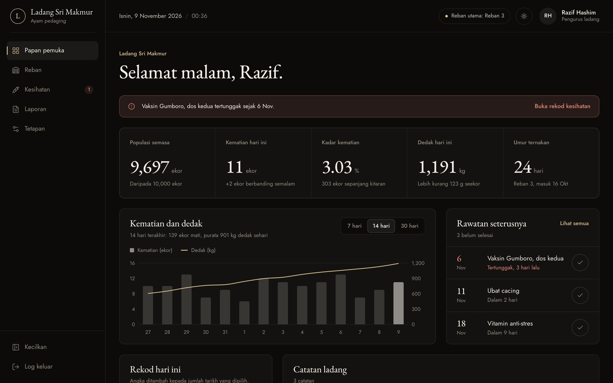
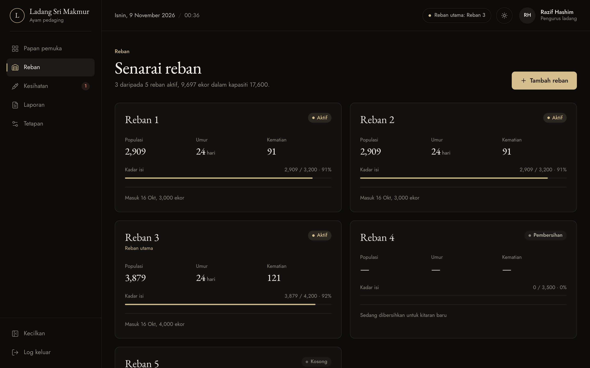
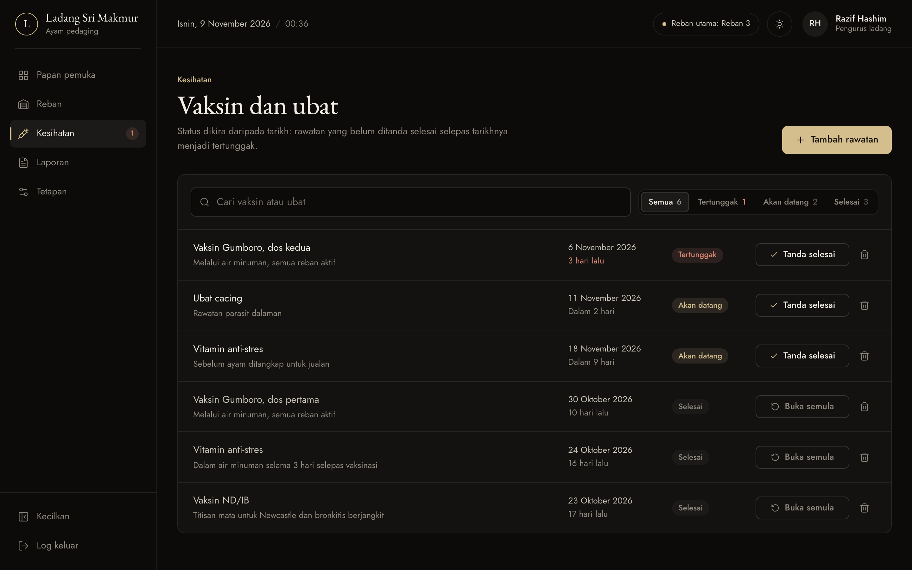

# Ayam Pedaging

[](https://github.com/marvinkeene-dua/ayam-pedaging/actions/workflows/ci.yml)

A daily record-keeping app for broiler chicken farms. A farm manager logs deaths, feed and notes for each coop, and the dashboard turns those entries into the numbers that decide a flock's health: population, mortality rate, feed per bird and flock age, plus a vaccination schedule that flags anything overdue.

**Live demo:** https://marvinkeene-dua.github.io/ayam-pedaging/ · The interface is in Bahasa Melayu for Malaysian farm staff.



## The problem

A broiler flock lives about 35 to 42 days, and small daily signals matter: a rise in deaths or a drop in feeding is often the first sign of disease or heat stress, and a vaccination missed by a few days leaves the whole flock exposed. On many small farms these records live in a notebook, so the numbers are never added up until something has already gone wrong.

## What it does

- **Daily entry in one form.** Deaths, feed and a note, for any coop and any date up to today. Several entries on the same day add together, which matches how workers report during a shift.
- **Figures that are always consistent.** Population, cumulative mortality and mortality rate are calculated from the coop records and the daily log on every render. Nothing is stored twice, so nothing can drift.
- **Treatments flag themselves.** A vaccination past its date and not marked done becomes overdue on its own. It shows in a banner, a sidebar count and a filter. Marking one done has an undo.
- **Coop management.** Add, edit and delete coops, with validation: unique names, population not above capacity, placement date not in the future. Flock age is counted from the placement date.
- **Reports.** 7, 14 or 30-day summaries, a CSV export that opens cleanly in Excel, and a print layout.
- Light and dark themes, a phone layout, browser back-button support, and undo on every delete.

| Coops | Health records |
|---|---|
|  |  |

## Engineering decisions

**Derive, don't duplicate.** The first version stored dashboard statistics separately from the coops, so editing a coop left the dashboard wrong. Now `ringkasanLadang()` computes every headline figure from two sources of truth: coops and the daily log. Vaccination status is derived from the date in the same way (`statusVaksin()`).

**Business rules out of components.** Applying a daily entry touches three pieces of state: coop population, the day's log row and the notes. That logic lives in a pure function, `gunaKemaskini()` in `src/lib/kemaskini.ts`, which the React component calls. This makes the rules unit-testable: deaths never take a population below zero, same-day entries merge, back-filled days stay in date order, and feed totals don't accumulate float error (0.1 + 0.1 + 0.1 is stored as 0.3). It also keeps untouched state referentially equal, so React skips unnecessary re-renders.

**Dates without time zones.** Dates are stored as local `YYYY-MM-DD` strings and parsed at local noon. Using `toISOString()` reports yesterday's date between midnight and 08:00 in Malaysia (UTC+8); the tests pin that down.

**Bundle size.** Recharts made up most of a 630 KB bundle. The chart and every page except the dashboard are now loaded on demand, which cut the JavaScript needed for first paint from 188 KB to 74 KB gzipped.

**Sample data that obeys the same rules.** The demo data is generated relative to today, so the demo never looks stale. A unit test checks that it is internally consistent: the deaths in the log equal the drop in coop populations.

**Accessibility.** Visible labels on every field, errors under their field with `aria-invalid`, focus moved to the first invalid field, dialogs that trap focus and close on Escape, a skip link, keyboard-reachable everything, and reduced motion respected.

## Stack

React 19, TypeScript (strict), Vite, Tailwind CSS 4, Recharts, Vitest, Playwright, Oxlint, GitHub Actions.

## Testing

| Layer | Tool | What it covers |
|---|---|---|
| Domain | Vitest, 26 tests | Daily-entry rules, derived statistics, treatment status and ordering, flock age, date maths across month, year and leap-day boundaries, CSV quoting (RFC 4180) and Excel encoding, sample-data consistency |
| End to end | Playwright, 13 tests | Every page and flow against the **production build**: validation, persistence across reload, undo, CSV contents, theme, sign-out; phone layout with no sideways scroll; fails on any console error |
| CI | GitHub Actions | Lint, typecheck, unit and end-to-end tests on every push; the main branch deploys to GitHub Pages |

## Running it

```bash
npm install
npm run dev        # http://localhost:5173
npm run check      # lint + typecheck + unit tests + build
npm run test:e2e   # Playwright (uses your installed Chrome locally)
```

## What I would build next

- **A backend with sign-in**, so several workers can log entries for the same farm from their phones.
- **Weight sampling**, so the app can report a real feed conversion ratio (FCR) instead of feed per bird.
- **Alerts** when daily mortality crosses a threshold, for example 0.2% of the flock.
- **Offline support** (service worker plus a sync queue) for coops with poor signal.
